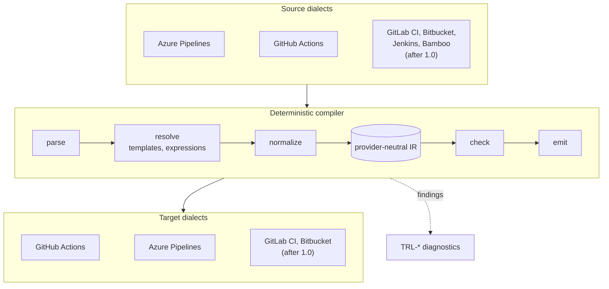
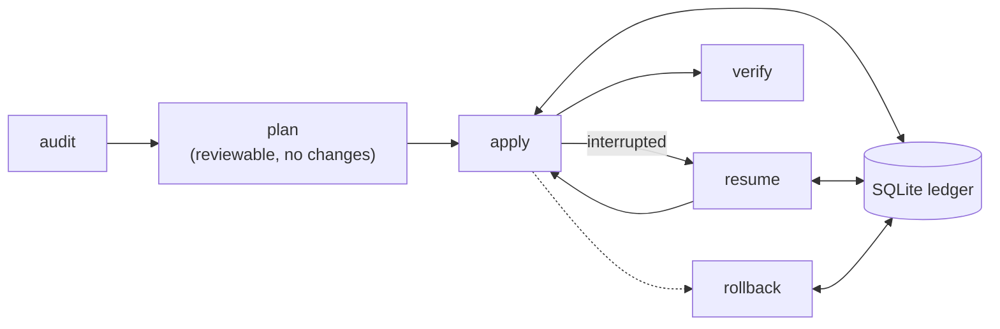

<p align="center">
  <picture>
    <source media="(prefers-color-scheme: dark)" srcset="docs/assets/trasloco-logo-dark.svg">
    
  </picture>
</p>

<h3 align="center">Building an open-source, any-to-any CI/CD migration engine.<br>
Provider-neutral, deterministic and auditable by design.</h3>

<p align="center">
  <a href="https://github.com/HarnageaGabriel/trasloco/actions/workflows/ci.yml">
    </a>
  <a href="go.mod">
    </a>
  <a href="LICENSE">
    </a>
  <a href="https://scorecard.dev/viewer/?uri=github.com/HarnageaGabriel/trasloco">
    </a>
  
</p>

<p align="center">
  <a href="#check-your-pipelines-for-retired-tasks-today">Retired tasks check</a> ·
  <a href="#why-trasloco">Why</a> ·
  <a href="#platforms">Platforms</a> ·
  <a href="#status">Status</a> ·
  <a href="#how-it-works">How it works</a> ·
  <a href="#quick-start">Quick start</a> ·
  <a href="#roadmap">Roadmap</a> ·
  <a href="#get-involved">Get involved</a>
</p>

**trasloco** (Italian for "house move") is an open-source Go CLI being built
to migrate CI/CD pipelines and the DevOps resources around them between
platforms. Its architecture is built around a provider-neutral intermediate
representation (IR): source dialects compile into the IR and target emitters
consume it, so each new platform connects to all the others without pairwise
converters: **any to any**.

The first pair is **Azure DevOps <-> GitHub**, plus `modernize` to upgrade
Azure Pipelines in place. GitLab CI, Bitbucket Pipelines, Jenkins and Bamboo
follow on the same IR. trasloco is free software under Apache-2.0 and will
stay free.

> [!WARNING]
> **Pre-alpha: no migration command works yet.** Only `version` and help are
> functional; every migration and management command exits with a
> "not implemented" error. What exists today is the foundation
> (configuration, diagnostics, ledger, HTTP and rate-limiting libraries) and
> most of the Azure Pipelines front end (YAML parser, expression engine,
> template resolver). Interfaces will change. If you need to migrate to GitHub
> today, see
> [trasloco and GitHub Actions Importer](#trasloco-and-github-actions-importer).
> To follow progress, star the repository and watch releases.

## Check your pipelines for retired tasks today

Microsoft has scheduled 73 built-in task versions in **Azure DevOps Services**
for retirement on **2026-10-15**; on **2027-03-15** they are removed, and
pipelines that still reference them fail
([official announcement](https://learn.microsoft.com/en-us/azure/devops/pipelines/tasks/task-retirement)).

trasloco already ships that list in machine-readable form,
[`catalog/azure-pipelines/tasks.retirement.yaml`](catalog/azure-pipelines/tasks.retirement.yaml),
generated from the announcement. Built-in task replacements are listed
directly; cases that need an external replacement are marked `external`.
You can use it right now, without installing anything, to find candidate
references to retired tasks in the YAML files of a checked-out repository:

```sh
# bash (Linux, macOS, Git Bash, WSL)
curl -fsSL https://raw.githubusercontent.com/HarnageaGabriel/trasloco/main/catalog/azure-pipelines/tasks.retirement.yaml \
  | sed -n 's/^ *- task: //p' > retired-tasks.txt
grep -rniwF -f retired-tasks.txt --include='*.yml' --include='*.yaml' .
```

```powershell
# PowerShell
$url = 'https://raw.githubusercontent.com/HarnageaGabriel/trasloco/main/catalog/azure-pipelines/tasks.retirement.yaml'
$retired = (Invoke-RestMethod $url) -split "`n" |
  Select-String '^\s*- task: (\S+)' |
  ForEach-Object { $_.Matches[0].Groups[1].Value }
$names = ($retired | ForEach-Object { [regex]::Escape($_) }) -join '|'
$pattern = '(?<![A-Za-z0-9_])(?:' + $names + ')(?![A-Za-z0-9_])'
Get-ChildItem -Recurse -Include *.yml, *.yaml | Select-String -Pattern $pattern
```

This is a plain-text candidate search: it can report matches in comments or
unrelated values, and it does not see classic (UI-defined) pipelines or task
names built from template parameters. The planned `modernize` command is
designed to analyze pipelines through the parser and template resolver and
rewrite supported tasks for you.

## Why trasloco

Moving pipelines between platforms is usually a manual rewrite: templates,
variables, expressions and secrets are translated by hand, one repository at a
time, which makes the result hard to audit consistently. trasloco treats a
migration like a compiler plus an infrastructure tool. These are the design
goals the code is being built to:

- **Deterministic by design.** Pipelines go through parse -> resolve ->
  normalize -> check -> emit. The same normalized input, catalog version and
  configuration give the same output, and every construct that cannot be
  converted is reported as a diagnostic instead of being silently guessed.
- **Any to any.** Dialects and emitters only talk to the provider-neutral IR,
  so adding a platform does not mean writing a converter for every pair.
- **Plan before mutation.** Platform changes (repositories, variables,
  environments, secrets) will follow a Terraform-like `plan` / `apply` /
  `resume` / `rollback` lifecycle recorded in a local SQLite ledger. The
  ledger exists today; the commands do not yet.
- **Built for fleets.** The HTTP layer already implements rate limiting,
  bounded retries and credential selection, as the foundation for migrating
  organizations with many repositories.
- **Secrets by reference.** The IR types store secret references, not secret
  values, and the logging, event and diagnostic layers redact registered
  values. End-to-end secret migration is not implemented yet.
- **No AI required, no telemetry.** Conversion is rule-based and reproducible,
  and trasloco sends nothing anywhere except to the platforms you configure.

## Platforms

| Platform | As a source | As a target |
|---|---|---|
| Azure Pipelines | 🛠️ in progress (parser, expressions and templates done) | 🗓️ planned (`modernize` in M2, full emitter in M6) |
| GitHub Actions | 🗓️ planned (M6) | 🗓️ planned (M2) |
| GitLab CI | 🗓️ after 1.0 | 🗓️ after 1.0 |
| Bitbucket Pipelines | 🗓️ after 1.0 | 🗓️ after 1.0 |
| Jenkins (declarative) | 🗓️ after 1.0 | not planned |
| Bamboo | 🗓️ after 1.0 | not planned |

Migrating *to* Jenkins or Bamboo is not on the roadmap, but nothing in the IR
prevents it.

## Status

| Area | Status | Milestone |
|---|---|---|
| Foundations: CLI skeleton, config, diagnostics, events, redaction, ledger, HTTP, rate limiting, credential pool, cache | ✅ done | M0 |
| Azure Pipelines YAML parser with source positions | ✅ done | M1 |
| Azure Pipelines expressions (`${{ }}`, `$[ ]`, `$( )`) | ✅ done | M1 |
| Azure Pipelines template resolver | ✅ done | M1 |
| Azure Pipelines variable evaluator | 🔍 in review | M1 |
| Azure Pipelines -> IR normalization | 🔍 in review | M1 |
| Task retirement catalog (73 task versions) and in-box task catalog | ✅ done | M2 |
| Curated task -> action mappings | 🗓️ planned | M2 |
| GitHub Actions emitter, `convert`, `modernize` | 🗓️ planned | M2 |
| `audit` | 🗓️ planned | M3 |
| `plan` / `apply` / `resume` / `rollback` | 🗓️ planned (ledger done) | M4 |
| GitHub -> Azure DevOps | 🗓️ planned | M6 |

"In review" means the code is in an open pull request and not yet on `main`.

## trasloco and GitHub Actions Importer

[GitHub Actions Importer](https://docs.github.com/en/actions/tutorials/migrate-to-github-actions/automated-migrations/use-github-actions-importer)
is GitHub's official tool for planning and automating migrations **to GitHub
Actions** from Azure DevOps, Bamboo, Bitbucket, CircleCI, GitLab, Jenkins and
Travis CI, with `audit`, `forecast`, `dry-run` and `migrate` commands and
custom transformers. It runs as a GitHub CLI extension with Docker. **If you
need to move to GitHub Actions today, use it**: trasloco cannot convert
anything yet.

trasloco's planned scope is complementary:

- **Both directions and any pair**, including GitHub -> Azure DevOps.
- **`modernize`**: upgrade Azure Pipelines in place, without changing platform.
- **The resources around pipelines**: variables, environments, secrets by
  reference, repositories and cutover, with a reviewable plan, resumable apply
  and rollback.
- **A single static binary** with no container runtime, and an open engine
  you can read, audit and extend.

## How it works

The diagrams show the planned architecture; the [status table](#status) shows
what is implemented today.



Platform changes follow a plan/apply lifecycle backed by the ledger:



## Built on evidence

Migration tools fail on the edge cases, so trasloco is tested against them:

- **319 Azure Pipelines fixtures** in
  [`testdata/azurepipelines/corpus`](testdata/azurepipelines/corpus): 230 valid
  pipelines, 44 template fragments and 45 invalid pipelines with their expected
  diagnostics.
- **446 expression vectors and 296 YAML structure vectors** written as tables
  in the [normative specifications](docs/spec/README.md); the tests load them
  directly from the Markdown.
- **Every semantic rule cites its source**: the Microsoft or GitHub
  documentation page, or a captured behaviour.
- **Fuzzing** of parsers and decoders, race-detector runs and coverage floors
  in CI.
- **Catalogs generated from upstream data**: 159 in-box Azure Pipelines tasks
  from [microsoft/azure-pipelines-tasks](https://github.com/microsoft/azure-pipelines-tasks)
  and the 73 retired task versions from the official announcement.

## Quick start

There is no release yet. Build from source with Go 1.26 or newer (see
[go.mod](go.mod)):

```sh
git clone https://github.com/HarnageaGabriel/trasloco.git
cd trasloco
make build                # or: go build -o bin/trasloco ./cmd/trasloco
./bin/trasloco version
./bin/trasloco --help     # the planned command surface
```

Only `version` and help are functional today. Developer commands:

```sh
make test        # go test -race ./...
make lint        # golangci-lint
make vuln        # govulncheck
make docs-check  # generated diagnostics docs are up to date
```

## Design principles

- Plan before mutation, and make every change reviewable.
- Keep secrets out of configuration, logs and every generated artifact.
- Prefer deterministic conversion with explicit, diagnosed unsupported cases.
- Use least privilege, pinned actions, resumable execution and verification.
- Built only from public documentation; every semantic claim cites its source.

## Roadmap

- **M0 - Foundations** ✅: CLI, config, diagnostics, events, redaction,
  ledger, HTTP, rate limiting, credential pool, cache.
- **M1 - Azure Pipelines dialect** 🛠️: parser, expressions, template
  resolver, variables, normalization to IR.
- **M2 - GitHub Actions emitter, catalog, `convert` and `modernize`**, with a
  possible early 0.x release of `convert` and `modernize`.
- **M3 - Platform adapters and `audit`.**
- **M4 - `plan` / `apply` / `resume` / `rollback` to GitHub.**
- **M5 - Hard cases:** OIDC and workload identity federation, classic
  pipelines, deployment jobs, matrices.
- **M6 - GitHub -> Azure DevOps.**
- **M7 - Repositories, governance metadata and cutover.**
- **Then:** hardening, private beta and **1.0**; after 1.0, GitLab CI,
  Bitbucket Pipelines, Jenkins and Bamboo.

## Get involved

- ⭐ **Star** the repository and **watch releases** to hear when `convert`
  and `modernize` land.
- 🧩 **Request a task mapping** or report a construct that other tools get
  wrong, with the [issue templates](https://github.com/HarnageaGabriel/trasloco/issues/new/choose).
  Anonymized real-world pipelines that break converters are the most valuable
  contribution.
- 🛠️ **Contribute code**: read [CONTRIBUTING.md](CONTRIBUTING.md) and
  [CONVENTIONS.md](CONVENTIONS.md) first; every commit needs a DCO sign-off
  (`git commit -s`). This project follows the
  [Code of Conduct](CODE_OF_CONDUCT.md).
- 🔒 **Report vulnerabilities privately** as described in
  [SECURITY.md](SECURITY.md), never in public issues.

## FAQ

**Is trasloco free?** Yes, always: Apache-2.0, with no paid edition and no
feature gates.

**Does it send my pipelines anywhere?** No. trasloco has no telemetry and is
designed to run entirely on your machine or CI runner, talking only to the
platforms you configure.

**Does it use AI?** Conversion is deterministic and needs no AI. Optional,
opt-in assistance for constructs without a deterministic mapping is on the
roadmap.

**Why Azure DevOps and GitHub first?** Many organizations run both side by
side and move work between them, and the Azure Pipelines task retirement makes
`modernize` urgent. The IR is designed so that more platforms follow.

## Documentation

| Where | What |
|---|---|
| [docs/spec](docs/spec/README.md) | Normative specifications (IR, expressions, YAML structure, variables, selectors, naming, events, exit codes, ...) |
| [docs/adr](docs/adr/README.md) | Architecture decision records |
| [docs/diagnostics](docs/diagnostics/README.md) | Every `TRL-*` diagnostic code |
| [catalog](catalog) | Generated task, action and retirement catalogs |
| [CONVENTIONS.md](CONVENTIONS.md) | Coding, testing and review conventions |
| [CONTRIBUTING.md](CONTRIBUTING.md) | How to contribute (DCO sign-off required) |
| [SECURITY.md](SECURITY.md) | Vulnerability reporting (private reporting enabled) |
| [TRADEMARKS.md](TRADEMARKS.md) | Use of the trasloco name |

## Professional services

trasloco is and will remain free. If you want help planning or running a
pipeline migration, or upgrading Azure Pipelines before the task removal date,
the maintainer offers professional migration services:
gabriel.harnagea06@gmail.com.

## License

Apache License 2.0. See [LICENSE](LICENSE) and [NOTICE](NOTICE). The
"trasloco" name and logo are covered by the [trademark policy](TRADEMARKS.md).
