<p align="center">
  <picture>
    <source media="(prefers-color-scheme: dark)" srcset="docs/assets/trasloco-logo-dark.svg">
    
  </picture>
</p>

<h3 align="center">An open-source tool, in the making, to move CI/CD pipelines<br>
between Azure DevOps, GitHub and more. Predictable and reviewable by design.</h3>

<p align="center">
  <a href="https://github.com/HarnageaGabriel/trasloco/actions/workflows/ci.yml">
    </a>
  <a href="go.mod">
    </a>
  <a href="LICENSE">
    </a>
  <a href="https://scorecard.dev/viewer/?uri=github.com/HarnageaGabriel/trasloco">
    </a>
  
</p>

<p align="center">
  <a href="#try-it-now-find-retired-azure-pipelines-tasks">Try it now</a> ·
  <a href="#design-goals">Design goals</a> ·
  <a href="#status">Status</a> ·
  <a href="#how-it-works">How it works</a> ·
  <a href="#getting-started">Getting started</a> ·
  <a href="#roadmap">Roadmap</a> ·
  <a href="#contributing">Contributing</a>
</p>

<p align="center">
  <picture>
    <source media="(prefers-color-scheme: dark)" srcset="docs/assets/readme-hero-dark.svg">
    
  </picture>
</p>

**trasloco** (Italian for "house move") moves CI/CD pipelines, and the DevOps
resources around them, from one platform to another. Like a house move, it
packs each pipeline into one box that belongs to no platform, the **trasloco
format**, and unpacks it on the target platform. Think Pandoc, but for CI/CD
pipelines: every new platform works with all the others, **any platform to any
platform**.

The first pair is **Azure DevOps <-> GitHub**. The shipped `modernize --check`
finds retired Azure Pipelines tasks; `modernize --write` rewrites class A/B
tasks with the specification's fail-closed guards; class C/D tasks are never
edited and are reported for manual migration. Do not run it concurrently with
other tools that edit the same files. Replacement preserves permission bits and
attempts uid/gid preservation on Unix, but does not preserve ACLs, extended
attributes or Windows alternate data streams. trasloco
is free software under Apache-2.0 and will stay free.

> [!WARNING]
> **Pre-alpha: platform migration is not yet implemented.** What exists today
> includes `modernize --check` and `modernize --write`, the foundation, and the complete
> Azure Pipelines reader (YAML parser, expressions, templates, variables,
> packing into the trasloco format); see
> [Status](#status). Interfaces will change. To
> migrate to GitHub today, see
> [trasloco and GitHub Actions Importer](#trasloco-and-github-actions-importer).
> Star the repository and watch releases to follow progress.

## Try it now: find retired Azure Pipelines tasks

Install the [latest trasloco release](https://github.com/HarnageaGabriel/trasloco/releases/latest)
using the [installation guide](docs/install.md), then check a repository:

```sh
trasloco modernize --check --format text -- .
```

Or rewrite what can be rewritten safely (add `--check` to fail if anything is left):

```sh
trasloco modernize --write -- .
```

`--write` edits only class A and B tasks, each behind fail-closed guards that
leave a step untouched when the rewrite is not provably safe; class C and D
tasks are only reported, never edited.

<p align="center">
  
</p>

Or add the GitHub Action to an existing workflow:

```yaml
- uses: HarnageaGabriel/trasloco@v0
  with:
    path: .
    fail-on-findings: true
    strict: true
```

Microsoft has scheduled 73 built-in task versions in **Azure DevOps Services**
for retirement on **2026-10-15**; on **2027-03-15** they are removed and
pipelines that still use them fail
([official announcement](https://learn.microsoft.com/en-us/azure/devops/pipelines/tasks/task-retirement)).
trasloco ships that list as data and checks pipeline YAML with its full parser.
Look up any retired task and its replacement on the
[task retirement site](https://harnageagabriel.github.io/trasloco/).

Exit status 5 means actionable retired tasks remain; 0 means the check passed.
The installation guide also covers Azure Pipelines and SARIF upload. The Action
verifies the signed checksum bundle with cosign and then the archive checksum;
the Azure Pipelines snippet checks only the archive checksum. The full Linux,
macOS, and Windows recipes additionally require an authenticated GitHub CLI for
`gh attestation verify`.

## Design goals

What trasloco is being built to do; the [status table](#status) shows what
exists today.

- **Any platform to any platform.** Every pipeline is packed into the
  trasloco format and unpacked from it, so adding a platform means teaching
  trasloco one format, not writing a converter for every pair.
- **Predictable.** The same pipeline, catalog version and configuration
  always give the same result. Anything that cannot be converted is listed
  clearly, never silently guessed.
- **Plan before you change anything.** Changes to the platforms (repositories,
  variables, environments, secrets) follow a `plan` / `apply` / `resume` /
  `rollback` lifecycle recorded in a local SQLite file, like Terraform.
- **`modernize` in place.** Upgrade Azure Pipelines without changing platform:
  replace retired tasks, actions and runner images.
- **Secrets stay secret.** The trasloco format stores references to secrets,
  never their values, and every log, event and diagnostic goes through
  redaction.
- **Built for fleets.** Rate limiting, bounded retries and credential
  selection are built into the HTTP layer, for organizations with many
  repositories.
- **Local and private.** One self-contained Go binary, no container runtime,
  no AI required and no telemetry.

## Status

| Component | Status | Milestone |
|---|---|---|
| Foundations: CLI, config, diagnostics, events, redaction, ledger, HTTP, rate limiting, credential pool, cache | Done | M0 |
| Azure Pipelines YAML parser, with exact source positions | Done | M1 |
| Azure Pipelines expressions (`${{ }}`, `$[ ]`, `$( )`) | Done | M1 |
| Azure Pipelines template expansion | Done | M1 |
| Azure Pipelines variables | Done | M1 |
| Azure Pipelines -> trasloco format | Done | M1 |
| Task retirement catalog (73 task versions) and built-in task catalog | Done | M2 |
| `modernize --check` retired-task reporting (no rewrites) | Done | M2 / 0.1.0 |
| Curated task -> action mappings | Planned | M2 |
| Class A/B `modernize --write` with fail-closed guards; C/D never edited | Done | M2 |
| GitHub Actions output and `convert` | Planned | M2 |
| `audit` | Planned | M3 |
| `plan` / `apply` / `resume` / `rollback` (the ledger is done) | Planned | M4 |
| GitHub -> Azure DevOps | Planned | M6 |
| GitLab CI, Bitbucket Pipelines (both ways); Jenkins, Bamboo (as sources) | Planned | after 1.0 |

In the CLI, `version`, `completion`, help, `modernize --check`, and
`modernize --write` work today. Conversion is not yet implemented.

## trasloco and GitHub Actions Importer

[GitHub Actions Importer](https://docs.github.com/en/actions/tutorials/migrate-to-github-actions/automated-migrations/use-github-actions-importer)
is GitHub's official tool for planning and automating migrations **to GitHub
Actions** from Azure DevOps, Bamboo, Bitbucket, CircleCI, GitLab, Jenkins and
Travis CI, with `audit`, `forecast`, `dry-run` and `migrate` commands and
custom transformers. It runs as a GitHub CLI extension with Docker. **If you
need to move to GitHub Actions today, use it**: trasloco cannot convert
anything yet.

trasloco's planned scope is complementary:

- **Both directions and any pair**, including GitHub -> Azure DevOps.
- **`modernize`**: upgrade Azure Pipelines in place, without changing platform.
- **The resources around pipelines**: variables, environments, secrets by
  reference, repositories and cutover, with a reviewable plan, resumable apply
  and rollback.
- **A self-contained binary** with no container runtime, and an open engine
  you can read, audit and extend.

## How it works

A pipeline goes through five steps. Steps 1 to 3 exist today for Azure
Pipelines; steps 4 and 5 are planned.

1. **Read** the source YAML, keeping the exact position of every value.
2. **Expand** templates and compile-time expressions.
3. **Pack** the result into the trasloco format.
4. **Check** it and list everything that cannot be converted.
5. **Unpack** it: write the pipeline for the target platform.

Changes to the platforms themselves will follow a reviewable lifecycle, with
every step recorded in a local ledger so an interrupted run can resume:

<p align="center">
  <picture>
    <source media="(prefers-color-scheme: dark)" srcset="docs/assets/readme-lifecycle-dark.svg">
    
  </picture>
</p>

## Built on evidence

Migration tools fail on the edge cases, so trasloco is tested against them:

- **319 Azure Pipelines fixtures** in
  [`testdata/azurepipelines/corpus`](testdata/azurepipelines/corpus): 230 valid
  pipelines and template files, 45 invalid pipelines with their expected
  diagnostics, and 44 unrendered starter templates vendored from
  microsoft/azure-pipelines-yaml (kept for coverage, not yet parsed).
- **446 expression vectors and 296 YAML structure vectors** written as tables
  in the [specifications](docs/spec/README.md); the tests load them directly
  from the Markdown.
- **Every vector cites its source**: a Microsoft documentation page or the
  open-source reference implementation. Rows inferred rather than documented
  are labelled as such.
- **Fuzzing** of parsers and decoders, race-detector runs and coverage floors
  in CI.
- **Catalogs generated from upstream data**: 159 built-in Azure Pipelines
  tasks from
  [microsoft/azure-pipelines-tasks](https://github.com/microsoft/azure-pipelines-tasks)
  and the 73 retired task versions from the official announcement.

## Getting started

Download a verified Linux, macOS, or Windows release using the
[installation guide](docs/install.md), or build from source with Go 1.26 or
newer (see [go.mod](go.mod)):

```sh
git clone https://github.com/HarnageaGabriel/trasloco.git
cd trasloco
make build                # or: go build -o bin/trasloco ./cmd/trasloco
./bin/trasloco version
./bin/trasloco modernize --check -- .
./bin/trasloco --help     # shipped and planned command surface
```

Developer commands:

```sh
make test        # go test -race ./...
make lint        # golangci-lint
make vuln        # govulncheck
make docs-check  # generated diagnostics docs are up to date
```

## Roadmap

| Milestone | Scope |
|---|---|
| M0 (done) | Foundations: CLI, config, diagnostics, events, redaction, ledger, HTTP, rate limiting, credential pool, cache |
| M1 (done) | Read Azure Pipelines: parser, expressions, templates, variables, packing into the trasloco format |
| M2 (in progress) | Task catalog, `modernize --check`, and `modernize --write` rewrites with fail-closed guards implemented; mappings, GitHub Actions output, and `convert` remain |
| M3 | Platform connections and `audit` |
| M4 | `plan` / `apply` / `resume` / `rollback` to GitHub |
| M5 | Hard cases: OIDC and workload identity federation, classic pipelines, deployment jobs, matrices |
| M6 | GitHub -> Azure DevOps |
| M7 | Repositories, governance metadata and cutover |
| 1.0 | Hardening and private beta, then the first stable release |
| After 1.0 | GitLab CI, Bitbucket Pipelines, Jenkins and Bamboo |

## Contributing

- **Follow progress**: star the repository and watch releases to hear when
  `convert` lands.
- **Try the retired tasks check** on your repositories and tell us what it
  misses, with the
  [issue templates](https://github.com/HarnageaGabriel/trasloco/issues/new/choose).
- **Share hard cases**: request a task mapping or report a construct that
  other tools get wrong. Anonymized real-world pipelines that break converters
  are the most valuable contribution.
- **Contribute code**: read [CONTRIBUTING.md](CONTRIBUTING.md) and
  [CONVENTIONS.md](CONVENTIONS.md) first; every commit needs a DCO sign-off
  (`git commit -s`). This project follows the
  [Code of Conduct](CODE_OF_CONDUCT.md).
- **Report vulnerabilities privately**, as described in
  [SECURITY.md](SECURITY.md), never in public issues.

## FAQ

<details>
<summary><b>Is trasloco free?</b></summary>

Yes, always: Apache-2.0, with no paid edition and no feature gates.
</details>

<details>
<summary><b>Does it send my pipelines anywhere?</b></summary>

No. trasloco has no telemetry and is designed to run entirely on your machine
or CI runner, talking only to the platforms you configure.
</details>

<details>
<summary><b>Does it use AI?</b></summary>

No. Conversion is rule-based and needs no AI. Optional, opt-in AI assistance
for constructs without a rule may come later; it is specified but not
scheduled.
</details>

<details>
<summary><b>Why Azure DevOps and GitHub first?</b></summary>

Many organizations run both side by side and move work between them, and the
Azure Pipelines task retirement makes `modernize` urgent. The trasloco format
is designed so that more platforms follow.
</details>

<details>
<summary><b>What is the "trasloco format"?</b></summary>

trasloco's own description of a pipeline, independent of any platform:
stages, jobs, steps, variables, conditions, and secrets as references. Pandoc
does the same for documents. In compiler terms it is an intermediate
representation (IR); its specification is [docs/spec/ir.md](docs/spec/ir.md).
</details>

## Documentation

| Where | What |
|---|---|
| [docs/spec](docs/spec/README.md) | Specifications (trasloco format, expressions, YAML structure, variables, naming, events, exit codes, ...) |
| [docs/adr](docs/adr/README.md) | Architecture decision records |
| [docs/diagnostics](docs/diagnostics/README.md) | Every `TRL-*` diagnostic code |
| [catalog](catalog) | Generated task, action and retirement catalogs |
| [CONVENTIONS.md](CONVENTIONS.md) | Coding, testing and review conventions |
| [CONTRIBUTING.md](CONTRIBUTING.md) | How to contribute (DCO sign-off required) |
| [SECURITY.md](SECURITY.md) | Vulnerability reporting (private reporting enabled) |
| [TRADEMARKS.md](TRADEMARKS.md) | Use of the trasloco name |

## Professional services

trasloco is and will remain free. If you want help planning or running a
pipeline migration, or upgrading Azure Pipelines before the task removal date,
the maintainer offers professional migration services:
gabriel.harnagea06@gmail.com.

## License

Apache License 2.0. See [LICENSE](LICENSE) and [NOTICE](NOTICE). The
"trasloco" name and logo are covered by the [trademark policy](TRADEMARKS.md).
