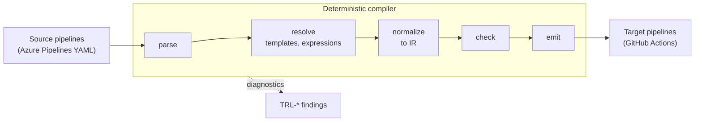
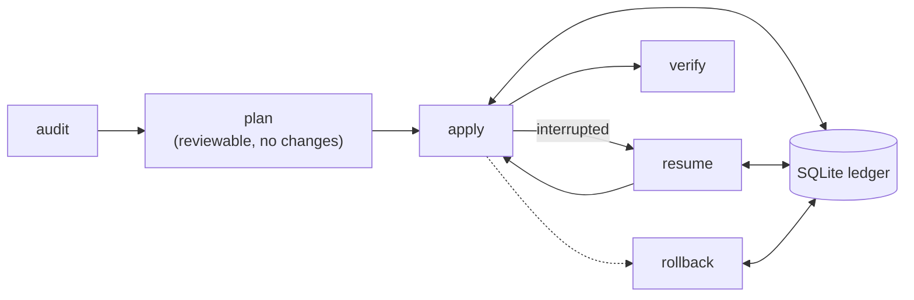

<p align="center">
  <picture>
    <source media="(prefers-color-scheme: dark)" srcset="docs/assets/trasloco-logo-dark.svg">
    
  </picture>
</p>

<p align="center">
  <strong>Auditable, deterministic CI/CD migrations between DevOps platforms.</strong>
</p>

<p align="center">
  <a href="https://github.com/HarnageaGabriel/trasloco/actions/workflows/ci.yml"></a>
  <a href="go.mod"></a>
  <a href="LICENSE"></a>
  <a href="https://scorecard.dev/viewer/?uri=github.com/HarnageaGabriel/trasloco"></a>
</p>

`trasloco` (Italian for "house move") is an open-source Go CLI for planning and
executing CI/CD pipeline and DevOps migrations between platforms. The first
target is Azure DevOps <-> GitHub, plus `modernize` for upgrading pipelines in
place. It is free software under Apache-2.0, and it will stay free.

> [!WARNING]
> **Pre-alpha.** No migration command works yet: every command except
> `version` exits with a "not implemented" error. What exists today is the foundation
> (configuration, diagnostics, ledger, HTTP and rate-limiting layers) and most
> of the Azure Pipelines front end (YAML parser, expression engine, template
> resolver). Interfaces will change. Do not use it on production pipelines.

## Why trasloco

Moving pipelines between platforms is usually a manual rewrite: templates,
variables, expressions and secrets are translated by hand, one repository at a
time, and nobody can say afterwards exactly what changed. trasloco treats a
migration like a compiler plus an infrastructure tool:

- **Deterministic compiler.** Pipelines go through parse -> resolve ->
  normalize -> check -> emit over a provider-neutral intermediate
  representation (IR). The same input always gives the same output, and every
  construct that cannot be converted produces a diagnostic instead of a silent
  guess.
- **Plan before you change anything.** Platform changes follow a
  Terraform-like `plan` / `apply` / `resume` / `rollback` lifecycle recorded in
  a local SQLite ledger, so an interrupted run can be resumed and every change
  can be traced.
- **Built for fleets.** HTTP access goes through shared rate limiting, retries
  and a credential pool, designed for organizations with hundreds or thousands
  of repositories.
- **Secrets stay references.** Secret values never reach logs, events,
  diagnostics, plans, reports or the cache; the tool moves references and
  tells you what must be re-created.

Azure Pipelines is retiring a set of built-in task versions: Microsoft
announced retirement on 2026-10-15 and removal on 2027-03-15 (see the
[task retirement page](https://learn.microsoft.com/en-us/azure/devops/pipelines/tasks/task-retirement)).
The planned `modernize` command targets exactly this: replacing retired tasks,
actions and runner images in existing pipelines.

## Feature status

| Area | Status | Milestone |
|---|---|---|
| Foundations: CLI skeleton, config, diagnostics, events, redaction, ledger, HTTP, rate limiting, cache | done | M0 |
| Azure Pipelines YAML parser (with source positions) | done | M1 |
| Azure Pipelines expressions (`${{ }}`, `$[ ]`, `$( )`) | done | M1 |
| Azure Pipelines template resolver | done (follow-up fix in review) | M1 |
| Azure Pipelines variable evaluator | in review | M1 |
| Azure Pipelines -> IR normalization | in review | M1 |
| Task/action mapping catalog | generator done; curated mappings planned | M2 |
| GitHub Actions emitter | planned | M2 |
| `convert` | planned | M2 |
| `modernize` | planned | M2 |
| `audit` | planned | M3 |
| `plan` / `apply` / `resume` / `rollback` | planned (ledger done) | M4 |
| GitHub -> Azure DevOps | planned | M6 |

"In review" means the code is in an open pull request and not yet on `main`.

## How it works



Platform changes (repositories, variables, environments, secrets) follow a
plan/apply lifecycle backed by the ledger:



## Quick start

There is no release yet. Build from source with Go 1.26 or newer (see
[go.mod](go.mod)) and `make`:

```sh
git clone https://github.com/HarnageaGabriel/trasloco.git
cd trasloco
make build
./bin/trasloco version
./bin/trasloco --help
```

On Windows the binary is `bin/trasloco.exe`. Only `version` and `--help` are
functional today; the other commands are placeholders that show the planned
command surface.

Developer commands:

```sh
make test        # go test -race ./...
make lint        # golangci-lint
make vuln        # govulncheck
make docs-check  # generated diagnostics docs are up to date
```

## Design principles

- Plan before mutation, and make every change reviewable.
- Keep secrets out of configuration, logs and every generated artifact.
- Prefer deterministic conversion with explicit, diagnosed unsupported cases.
- Use least privilege, pinned actions, resumable execution and verification.
- Built only from public documentation; every semantic claim cites its source.

## Documentation

| Where | What |
|---|---|
| [docs/spec](docs/spec/README.md) | Normative specifications (IR, expressions, YAML structure, variables, selectors, naming, events, exit codes, ...) |
| [docs/adr](docs/adr/README.md) | Architecture decision records |
| [docs/diagnostics](docs/diagnostics/README.md) | Every `TRL-*` diagnostic code |
| [CONVENTIONS.md](CONVENTIONS.md) | Coding, testing and review conventions |
| [CONTRIBUTING.md](CONTRIBUTING.md) | How to contribute (DCO sign-off required) |
| [SECURITY.md](SECURITY.md) | Vulnerability reporting (private reporting enabled) |
| [TRADEMARKS.md](TRADEMARKS.md) | Use of the trasloco name |

## Roadmap

- **M0 - Foundations** (done): CLI, config, diagnostics, events, redaction,
  ledger, HTTP, rate limiting, credential pool, cache.
- **M1 - Azure Pipelines dialect** (in progress): parser, expressions,
  template resolver, variables, normalization to IR.
- **M2 - GitHub Actions emitter, catalog, `convert` and `modernize`**; a
  possible early 0.x release of `convert` / `modernize`.
- **M3 - Platform adapters and `audit`.**
- **M4 - `plan` / `apply` / `resume` / `rollback` to GitHub.**
- **M5 - Hard cases:** OIDC/workload identity, classic pipelines, deployment
  jobs, matrices.
- **M6 - GitHub -> Azure DevOps.**
- **M7 - Repositories, governance metadata and cutover.**
- **Then:** hardening, private beta and **1.0**.

## Contributing

Contributions are welcome. Read [CONTRIBUTING.md](CONTRIBUTING.md) and
[CONVENTIONS.md](CONVENTIONS.md) first; every commit needs a DCO sign-off
(`git commit -s`). This project follows the
[Code of Conduct](CODE_OF_CONDUCT.md).

Report vulnerabilities privately as described in [SECURITY.md](SECURITY.md),
not in public issues.

## Professional services

trasloco is and will remain free. If you need help planning or running an
Azure DevOps <-> GitHub migration, the maintainer offers professional migration
services: gabriel.harnagea06@gmail.com.

## License

Apache License 2.0. See [LICENSE](LICENSE) and [NOTICE](NOTICE). The
"trasloco" name and logo are covered by the [trademark policy](TRADEMARKS.md).
