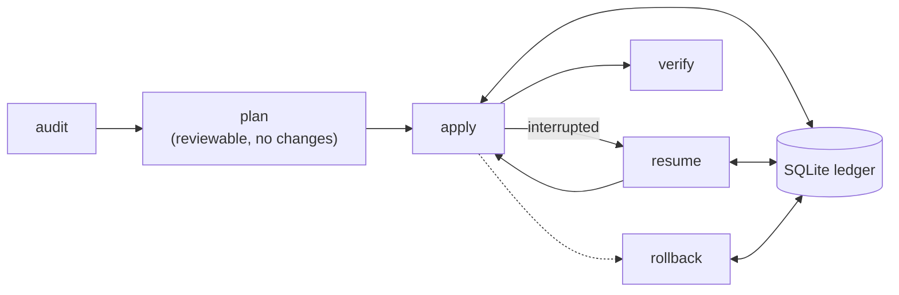

<p align="center">
  <picture>
    <source media="(prefers-color-scheme: dark)" srcset="docs/assets/trasloco-logo-dark.svg">
    
  </picture>
</p>

<h3 align="center">Building an open-source, any-to-any CI/CD migration engine.<br>
Provider-neutral, deterministic and auditable by design.</h3>

<p align="center">
  <a href="https://github.com/HarnageaGabriel/trasloco/actions/workflows/ci.yml">
    </a>
  <a href="go.mod">
    </a>
  <a href="LICENSE">
    </a>
  <a href="https://scorecard.dev/viewer/?uri=github.com/HarnageaGabriel/trasloco">
    </a>
  
</p>

<p align="center">
  <a href="#try-it-now-find-retired-azure-pipelines-tasks">Try it now</a> ·
  <a href="#key-features">Features</a> ·
  <a href="#status">Status</a> ·
  <a href="#how-it-works">How it works</a> ·
  <a href="#getting-started">Getting started</a> ·
  <a href="#roadmap">Roadmap</a> ·
  <a href="#contributing">Contributing</a>
</p>

<p align="center">
  <picture>
    <source media="(prefers-color-scheme: dark)" srcset="docs/assets/readme-hero-dark.svg">
    
  </picture>
</p>

**trasloco** (Italian for "house move") moves CI/CD pipelines, and the DevOps
resources around them, from one platform to another. Every source is compiled
into one provider-neutral intermediate representation (IR) and every target is
generated from it, so each new platform works with all the others.

The first pair is **Azure DevOps <-> GitHub**, plus `modernize` to upgrade
Azure Pipelines in place. trasloco is free software under Apache-2.0 and will
stay free.

> [!WARNING]
> **Pre-alpha: no migration command works yet.** What exists today is the
> foundation and most of the Azure Pipelines front end (YAML parser,
> expression engine, template resolver); see [Status](#status). Interfaces will
> change. To migrate to GitHub today, see
> [trasloco and GitHub Actions Importer](#trasloco-and-github-actions-importer).
> Star the repository and watch releases to follow progress.

## Key features

These are the goals the code is built to; the [status table](#status) shows
what is implemented today.

- **Any to any.** Source dialects and target emitters only talk to the IR, so
  adding a platform does not mean writing a converter for every pair.
- **Deterministic.** The same normalized input, catalog version and
  configuration always give the same output. Anything that cannot be converted
  is reported as a diagnostic, never silently guessed.
- **Plan before you change anything.** Platform changes (repositories,
  variables, environments, secrets) follow a `plan` / `apply` / `resume` /
  `rollback` lifecycle recorded in a local SQLite ledger, like Terraform.
- **`modernize` in place.** Upgrade Azure Pipelines without changing platform:
  replace retired tasks, actions and runner images.
- **Secrets stay secret.** The IR stores secret references, not secret values,
  and every log, event and diagnostic goes through redaction.
- **Built for fleets.** Rate limiting, bounded retries and credential selection
  are built into the HTTP layer, for organizations with many repositories.
- **Local and private.** One static binary, no container runtime, no AI
  required and no telemetry.

## Try it now: find retired Azure Pipelines tasks

Microsoft has scheduled 73 built-in task versions in **Azure DevOps Services**
for retirement on **2026-10-15**; on **2027-03-15** they are removed and
pipelines that still use them fail
([official announcement](https://learn.microsoft.com/en-us/azure/devops/pipelines/tasks/task-retirement)).
trasloco ships that list as data,
[`catalog/azure-pipelines/tasks.retirement.yaml`](catalog/azure-pipelines/tasks.retirement.yaml),
with the recommended replacements. Three lines of shell find the candidates in
any checked-out repository, with nothing to install:

<p align="center">
  
</p>

```sh
url=https://raw.githubusercontent.com/HarnageaGabriel/trasloco/main/catalog/azure-pipelines/tasks.retirement.yaml
curl -fsSL "$url" | sed -n 's/^ *- task: //p' > retired-tasks.txt
grep -rniwF -f retired-tasks.txt --include='*.yml' --include='*.yaml' .
```

<details>
<summary>PowerShell</summary>

```powershell
$url = 'https://raw.githubusercontent.com/HarnageaGabriel/trasloco/main/catalog/azure-pipelines/tasks.retirement.yaml'
$retired = (Invoke-RestMethod $url) -split "`n" |
  Select-String '^\s*- task: (\S+)' |
  ForEach-Object { $_.Matches[0].Groups[1].Value }
$names = ($retired | ForEach-Object { [regex]::Escape($_) }) -join '|'
$pattern = '(?<![A-Za-z0-9_])(?:' + $names + ')(?![A-Za-z0-9_])'
Get-ChildItem -Recurse -Include *.yml, *.yaml | Select-String -Pattern $pattern
```

</details>

This is a plain-text search: it can match comments, and it does not see
classic (UI-defined) pipelines or task names built from template parameters.
The planned `modernize` command is designed to analyze pipelines through the
parser and template resolver and rewrite supported tasks for you.

## Status

| Component | Status | Milestone |
|---|---|---|
| Foundations: CLI, config, diagnostics, events, redaction, ledger, HTTP, rate limiting, credential pool, cache | Done | M0 |
| Azure Pipelines YAML parser, with source positions | Done | M1 |
| Azure Pipelines expressions (`${{ }}`, `$[ ]`, `$( )`) | Done | M1 |
| Azure Pipelines template resolver | Done | M1 |
| Azure Pipelines variable evaluator | In review | M1 |
| Azure Pipelines -> IR normalization | In review | M1 |
| Task retirement catalog (73 task versions) and in-box task catalog | Done | M2 |
| Curated task -> action mappings | Planned | M2 |
| GitHub Actions emitter, `convert`, `modernize` | Planned | M2 |
| `audit` | Planned | M3 |
| `plan` / `apply` / `resume` / `rollback` (the ledger is done) | Planned | M4 |
| GitHub -> Azure DevOps | Planned | M6 |
| GitLab CI, Bitbucket Pipelines (source and target); Jenkins, Bamboo (source) | Planned | after 1.0 |

"In review" means the code is in an open pull request, not yet on `main`. Only
`version` and help work in the CLI today; every other command exits with a
"not implemented" error.

## trasloco and GitHub Actions Importer

[GitHub Actions Importer](https://docs.github.com/en/actions/tutorials/migrate-to-github-actions/automated-migrations/use-github-actions-importer)
is GitHub's official tool for planning and automating migrations **to GitHub
Actions** from Azure DevOps, Bamboo, Bitbucket, CircleCI, GitLab, Jenkins and
Travis CI, with `audit`, `forecast`, `dry-run` and `migrate` commands and
custom transformers. It runs as a GitHub CLI extension with Docker. **If you
need to move to GitHub Actions today, use it**: trasloco cannot convert
anything yet.

trasloco's planned scope is complementary:

- **Both directions and any pair**, including GitHub -> Azure DevOps.
- **`modernize`**: upgrade Azure Pipelines in place, without changing platform.
- **The resources around pipelines**: variables, environments, secrets by
  reference, repositories and cutover, with a reviewable plan, resumable apply
  and rollback.
- **A single static binary** with no container runtime, and an open engine
  you can read, audit and extend.

## How it works

A pipeline is designed to go through five stages, like a compiler. Parse and
resolve exist today for Azure Pipelines; normalize is in review.

1. **parse** reads the source YAML with exact source positions.
2. **resolve** expands templates and compile-time expressions.
3. **normalize** turns the result into the provider-neutral IR.
4. **check** validates the IR and reports what cannot be converted.
5. **emit** writes the pipeline for the target platform.

Changes to the platforms themselves will follow a reviewable lifecycle backed
by the ledger:



## Built on evidence

Migration tools fail on the edge cases, so trasloco is tested against them:

- **319 Azure Pipelines fixtures** in
  [`testdata/azurepipelines/corpus`](testdata/azurepipelines/corpus): 230 valid
  pipelines, 44 template fragments and 45 invalid pipelines with their expected
  diagnostics.
- **446 expression vectors and 296 YAML structure vectors** written as tables
  in the [normative specifications](docs/spec/README.md); the tests load them
  directly from the Markdown.
- **Every semantic rule cites its source**: the Microsoft or GitHub
  documentation page, or a captured behaviour.
- **Fuzzing** of parsers and decoders, race-detector runs and coverage floors
  in CI.
- **Catalogs generated from upstream data**: 159 in-box Azure Pipelines tasks
  from [microsoft/azure-pipelines-tasks](https://github.com/microsoft/azure-pipelines-tasks)
  and the 73 retired task versions from the official announcement.

## Getting started

There is no release yet. Build from source with Go 1.26 or newer (see
[go.mod](go.mod)):

```sh
git clone https://github.com/HarnageaGabriel/trasloco.git
cd trasloco
make build                # or: go build -o bin/trasloco ./cmd/trasloco
./bin/trasloco version
./bin/trasloco --help     # the planned command surface
```

Developer commands:

```sh
make test        # go test -race ./...
make lint        # golangci-lint
make vuln        # govulncheck
make docs-check  # generated diagnostics docs are up to date
```

## Roadmap

| Milestone | Scope |
|---|---|
| M0 (done) | Foundations: CLI, config, diagnostics, events, redaction, ledger, HTTP, rate limiting, credential pool, cache |
| M1 (in progress) | Azure Pipelines dialect: parser, expressions, template resolver, variables, normalization to IR |
| M2 | GitHub Actions emitter, catalog, `convert` and `modernize`; possible early 0.x release |
| M3 | Platform adapters and `audit` |
| M4 | `plan` / `apply` / `resume` / `rollback` to GitHub |
| M5 | Hard cases: OIDC and workload identity federation, classic pipelines, deployment jobs, matrices |
| M6 | GitHub -> Azure DevOps |
| M7 | Repositories, governance metadata and cutover |
| 1.0 | Hardening and private beta, then the first stable release |
| After 1.0 | GitLab CI, Bitbucket Pipelines, Jenkins and Bamboo |

## Contributing

- **Follow progress**: star the repository and watch releases to hear when
  `convert` and `modernize` land.
- **Share hard cases**: request a task mapping or report a construct that
  other tools get wrong, with the
  [issue templates](https://github.com/HarnageaGabriel/trasloco/issues/new/choose).
  Anonymized real-world pipelines that break converters are the most valuable
  contribution.
- **Contribute code**: read [CONTRIBUTING.md](CONTRIBUTING.md) and
  [CONVENTIONS.md](CONVENTIONS.md) first; every commit needs a DCO sign-off
  (`git commit -s`). This project follows the
  [Code of Conduct](CODE_OF_CONDUCT.md).
- **Report vulnerabilities privately**, as described in
  [SECURITY.md](SECURITY.md), never in public issues.

## FAQ

<details>
<summary><b>Is trasloco free?</b></summary>

Yes, always: Apache-2.0, with no paid edition and no feature gates.
</details>

<details>
<summary><b>Does it send my pipelines anywhere?</b></summary>

No. trasloco has no telemetry and is designed to run entirely on your machine
or CI runner, talking only to the platforms you configure.
</details>

<details>
<summary><b>Does it use AI?</b></summary>

Conversion is deterministic and needs no AI. Optional, opt-in assistance for
constructs without a deterministic mapping is on the roadmap.
</details>

<details>
<summary><b>Why Azure DevOps and GitHub first?</b></summary>

Many organizations run both side by side and move work between them, and the
Azure Pipelines task retirement makes `modernize` urgent. The IR is designed
so that more platforms follow.
</details>

## Documentation

| Where | What |
|---|---|
| [docs/spec](docs/spec/README.md) | Normative specifications (IR, expressions, YAML structure, variables, selectors, naming, events, exit codes, ...) |
| [docs/adr](docs/adr/README.md) | Architecture decision records |
| [docs/diagnostics](docs/diagnostics/README.md) | Every `TRL-*` diagnostic code |
| [catalog](catalog) | Generated task, action and retirement catalogs |
| [CONVENTIONS.md](CONVENTIONS.md) | Coding, testing and review conventions |
| [CONTRIBUTING.md](CONTRIBUTING.md) | How to contribute (DCO sign-off required) |
| [SECURITY.md](SECURITY.md) | Vulnerability reporting (private reporting enabled) |
| [TRADEMARKS.md](TRADEMARKS.md) | Use of the trasloco name |

## Professional services

trasloco is and will remain free. If you want help planning or running a
pipeline migration, or upgrading Azure Pipelines before the task removal date,
the maintainer offers professional migration services:
gabriel.harnagea06@gmail.com.

## License

Apache License 2.0. See [LICENSE](LICENSE) and [NOTICE](NOTICE). The
"trasloco" name and logo are covered by the [trademark policy](TRADEMARKS.md).
